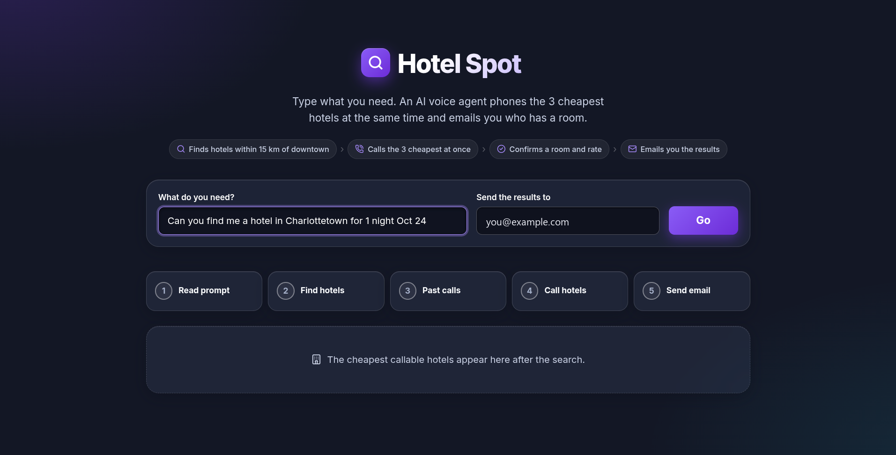
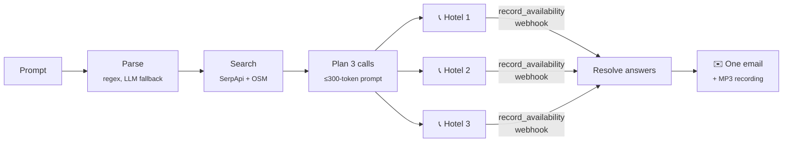

<div align="center">

# 🔎 Hotel Spot

**Type what you need. An AI voice agent phones the 3 cheapest hotels at the same time and emails you who has a room.**

Built by **Team 15** at the **TechTO "Fast & Frugal" Hackathon** · October 2026




</div>

---

## The problem

Online hotel prices often don't match what the front desk will actually give you, and the listings don't show whether a room is still free tonight. Finding out means phoning hotel after hotel and waiting on hold.

**Hotel Spot makes those calls for you, all at once.**

## What it does

You write one sentence, for example *"Can you find me a hotel in Charlottetown for 1 night Oct 24"*. Then Hotel Spot:

1. **🔍 Finds hotels.** It searches Google Hotels and vacation rentals and keeps only listings near downtown that have a phone number.
2. **📞 Calls the 3 cheapest at once.** An ElevenLabs voice agent phones all three in parallel. It finds its way through phone menus, waits politely on hold, and asks two things: *is there a room for these dates, and what's the lowest nightly rate?*
3. **✅ Confirms a room and rate.** The agent records the answer with a structured tool call while it's still on the phone.
4. **✉️ Emails you the results.** One email names the cheapest hotel with a room: its name, address, the number called, and the price for the stay. The **call recording** is attached so you can hear the answer for yourself.

> **It never books.** The agent only asks about availability and price. If anyone asks, it says honestly that it's an automated assistant.

## How it works



`pipeline.run(prompt)` runs every stage, and the CLI and the web UI both call it:

| Stage | Module | What happens |
|---|---|---|
| Parse | `agent_brain.py` | Regex turns the prompt into a typed `HotelRequest`. An LLM (Backboard) runs only if the regex can't parse it. |
| Search | `search_service.py` | SerpApi (Google Hotels and rentals) with detail lookups in parallel for phone numbers. OpenStreetMap filters out listings that are too far away. |
| Plan | `agent_brain.py` | One short call plan per hotel: the opening line, the dates, and any notes about that hotel. |
| Call | `voice_agent.py` | Outbound calls through ElevenLabs and Twilio, all running at once, each with a time cap. Detects voicemail and no answer. |
| Record | `tool_server.py` | A small webhook server takes the agent's `record_availability` tool call during the call (through an ngrok tunnel). |
| Resolve | `extractor.py` | Uses the tool result first, then a regex on the transcript, then an LLM, then "unknown". |
| Email | `email_service.py` | One plain-text email through Resend, with Gmail SMTP as a fallback, and the winner's MP3 attached. |
| Telemetry | `telemetry.py` | Timings, token counts and costs go to `run_telemetry.json`. |

## Fast & frugal by design

The hackathon scored on speed and on how few LLM tokens a run uses, so:

- **No LLM for work that has a fixed answer.** Parsing, sorting, distance filtering, formatting and validation are plain Python. The LLM is only a fallback, and it has a token budget.
- **The agent reports answers as structured data.** It fills in a tool call while it's on the phone, so nobody has to re-read the transcript with an LLM afterwards.
- **Calls run in parallel.** Three calls take about as long as one.
- **The voice agent replies quickly.** Median reply time is **0.77 s** (p90 1.04 s), measured turn by turn on live calls.
- **Search results are cached locally**, so running the same search again costs no API credits.

## Built for real front desks

Test calls are easy. Real hotels have phone menus, hold music, brand-name greetings, and staff who don't want to talk to a robot. Live calls showed these problems, and the agent now handles them:

| Real-world situation | What the agent does |
|---|---|
| Phone menu ("press 1 for reservations…") | Waits for a person to speak before talking, and follows the menu with keypad tones |
| "One moment, let me check" | Stays quiet on hold; never asks "are you still there?" |
| Answers with a brand name or a central reservations line | Carries on and asks about the right hotel |
| "Are you a robot?" | Answers honestly in one line, then asks the question again |
| Voicemail or no answer | Records it as that hotel's result and moves on |
| Wrapping up | Repeats only the price back, says "Thank you!" and hangs up |

Every call is also graded automatically by evaluation criteria on the agent: *did it get the answer, did it end promptly, did it never book.*

## Tech stack

| | |
|---|---|
| **Language** | Python 3.13 |
| **Voice and telephony** | ElevenLabs Agents (speech-to-text, LLM, text-to-speech, server tools), Twilio |
| **Search** | SerpApi (Google Hotels, vacation rentals), OpenStreetMap Nominatim |
| **LLM fallback** | Backboard (`gemini-2.5-flash-lite`), token-capped |
| **Email** | Resend API, Gmail SMTP fallback |
| **Backend** | Pydantic v2 data contracts, httpx, thread pools, a built-in HTTP webhook server, ngrok |
| **Frontend** | Streamlit |
| **Testing** | pytest: 262 tests, all offline, using faked HTTP |

## Run it

```bash
python -m venv .venv
source .venv/bin/activate        # Windows: .venv\Scripts\activate
pip install -r requirements.txt
cp .env.example .env             # fill in the keys you have

python -m pytest -q              # offline, no keys needed
```

**Safe test from the command line.** Keep `USE_MOCK_HOTEL=true` (the default) in `.env`, and it dials your `MOCK_HOTEL_PHONES` instead of real hotels:

```bash
python main.py "cheapest hotel in Toronto tonight" --email you@example.com
```

**Web UI** at http://localhost:8501:

```bash
streamlit run app.py
```

> ⚠️ The web UI is the live demo: **it calls real hotels**. Use the CLI with `USE_MOCK_HOTEL=true` to test.

Live calls need: `ELEVENLABS_API_KEY`, `ELEVENLABS_AGENT_ID`, `ELEVENLABS_AGENT_PHONE_NUMBER_ID`, `SERPAPI_API_KEY`, an email provider, and a public tunnel (`PUBLIC_BASE_URL`, `TOOL_SHARED_SECRET`) for the agent's webhook. [docs/ws3-voice.md](docs/ws3-voice.md) lists the agent settings, and [agents/booking_tool.json](agents/booking_tool.json) defines the tool.

## Project layout

```
pipeline.py         # the orchestrator: parse → search → plan → call → resolve → email
contracts.py        # Pydantic models shared by every module
config.py           # the only module that reads env vars
search_service.py   # hotel search, phone numbers, distance filter
agent_brain.py      # prompt parsing, call plans, LLM fallback
voice_agent.py      # ElevenLabs/Twilio calls, transcripts, outcomes
tool_server.py      # webhook for the agent's record_availability tool
extractor.py        # zero-token answer extraction from transcripts
email_service.py    # the one email, with the recording attached
telemetry.py        # timings, tokens and cost per run
app.py / main.py    # Streamlit UI / CLI
tests/              # 262 offline tests
docs/               # architecture, workstreams, git workflow, demo runbook
```

## Team 15

| | Workstream |
|---|---|
| **Jordan Bouckley** | Team lead · voice agent and telephony (ElevenLabs, Twilio) |
| **Richard Guo** | Hotel search, pipeline, UI and telemetry |
| **Zachary Gazaille** | Agent brain: prompt parsing, call plans, LLM fallback |
| **Isaac Ouellette** | Email, answer extraction, webhook tool server, pitch deck |

Each of us owned our own branch and files, with shared contracts changed only through small PRs. See [docs/git-workflow.md](docs/git-workflow.md).

## More reading

- [docs/architecture.md](docs/architecture.md): system design and data flow
- [docs/integration-and-demo.md](docs/integration-and-demo.md): test matrix and demo runbook
- [REFLECTION.md](REFLECTION.md): what we learned, including the failures we found on live calls
- [Hotel_Spot_Deck.pdf](Hotel_Spot_Deck.pdf): the pitch deck
